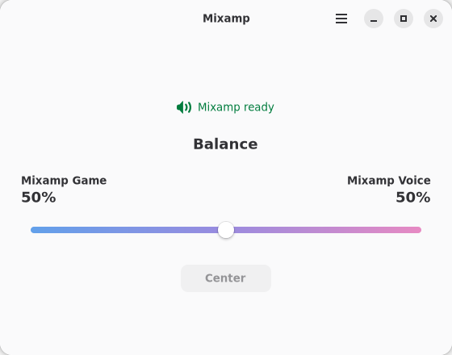

# Mixamp

Mixamp gives you separate Game and Voice audio outputs on Linux, with a single control to balance them, like the game/chat dial on some gaming headsets. Both outputs play through your system's default audio output.

## Install

Download the `.flatpak` file from the [latest release](https://github.com/TB516/mixamp/releases) and open it with your software center, or run this from the folder you downloaded it to:

    flatpak install --user mixamp-*.flatpak

Mixamp requires PipeWire, which most current Linux desktops use.

## Use

1. In your game's audio settings, choose **Mixamp Game** as the output.
2. In your chat app's audio settings, choose **Mixamp Voice**.
3. Move the balance toward Game to lower Voice, or toward Voice to lower Game. Center plays both at full volume.

Mixamp remembers your balance between sessions. If you allow background access, it keeps running after you close its window.

Game and chat audio need to come from separate apps for Mixamp to balance them.

## Development

Mixamp is under development. See [development setup](docs/development.md) to build it, run it, or contribute.
